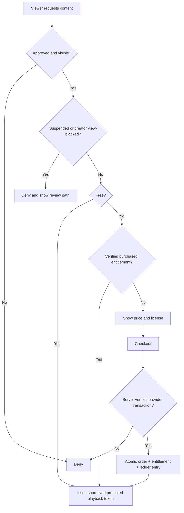

# Student Creators — Content Rights, Paid Access, Blocking & Safety
Founder directions documented 23 November 2026. This is a proposal/acceptance contract, not functioning code or legal advice.

## Author retains ownership; buyer buys access
Student creator owns the original content they have rights to, subject to applicable university contracts and third-party rights. Hosting provides the platform a limited license to store, process and display the work. Viewer purchases a defined **personal access/viewing entitlement**, not the work's copyright or source files. Access terms must state duration, permitted devices, cancellation, takedowns, refunds and whether downloads are allowed. Content purchases are not transfers of copyright.

## Protected playback authorization

A browser redirect is never proof of payment. Content must not be reachable by direct static URLs outside the authorization check. Signed tokens and delivery restrictions discourage unauthorized copying but do not guarantee prevention of screen recording.

## Creator controls
- **Deny viewing** of selected creator content to a verified account, enforced before every playback token issuance.
- **Deny commenting** on that creator's content separately, using server-side checks.
- **Deny DMs** to the creator, with consent controls and appropriate support evidence.
- Report harassment, impersonation, fraudulent activity, copyright infringement or ban evasion.
- Moderation and platform suspensions require logged decisions and an appeal path.

## Re-registration/ban evasion
Absolute prevention is not possible. Use private, verified student records and carefully reviewed duplicate detection to restrict confirmed repeat enrollments, with appeals. A shared campus IP is not proof of the same person. Avoid indiscriminate device fingerprinting, excessive identity collection and unreviewed automated accusations.

## Already-paid viewers
The terms must explicitly specify what happens if a creator blocks a person who already paid. Protect the creator during harassment, and route access disputes to a documented review/refund process. Do not silently erase entitlements, financial journal entries or refund obligations.

## Data model candidates — reconcile with current repo schema before applying
- content + copyright attestation + media asset + creator
- content price (NGN 0 or >= NGN 200)
- access terms version + scoped entitlement + verified order
- creator_user_restriction(view, comment, DM)
- moderation case + identity verification + audit event
- ledger journal + refund/chargeback adjustment

## Essential tests before a pilot
1. Viewer without an entitlement cannot access paid media through any endpoint or known media ID.
2. Verification+payment events are idempotent; retries yield one purchase entitlement and balanced ledger allocation.
3. Creator view-block immediately prevents **new** playback tokens; comment and DM restrictions work independently.
4. Cross-campus/cross-user permission checks and data privacy tests enforce the same rules in API/database as in UI.
5. Suspended creator/viewer, deleted content, refunded access and pending purchase states behave as documented.
6. Rights complaints, takedowns, reports and appeals preserve evidence and follow privacy requirements.
7. Student ID evidence, legal name and payment secrets never appear in public profiles or browser responses.

## Academic integrity
Permitted: original explanations, completed examples with redistribution rights, tutoring, legitimate project guidance, feedback on a student's own attempt. Not permitted: selling an answer to submit dishonestly as the purchaser's own graded assessment, leaked exams, stolen source materials or unauthorized faculty resources.

## Status
Design only in this change. We have not implemented or tested these new entitlement/blocking rules here.
