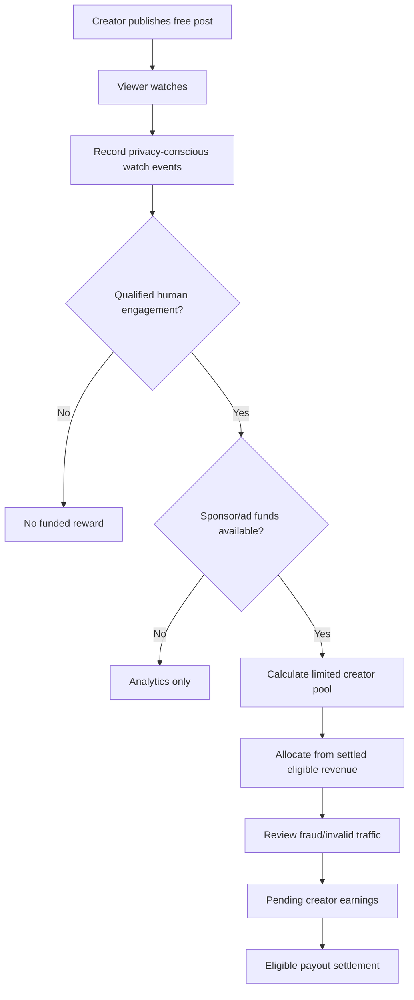

# Student Creators — Monetization and Global Expansion
Research-led founder planning, 23 November 2026. Not a live billing implementation. Provider fees and eligibility must be rechecked before production.

## Money model
- Creator may publish FREE (NGN 0) or charge >= NGN 200 for scoped **viewing access** only. Buyers do not acquire copyright.
- The platform charges a clearly disclosed percentage of verified sales. Commission, who bears PSP fees, payout threshold (NGN 5000 discussed), settlement cadence, refunds and tax treatment are NOT approved yet.
- Additional revenue to research: paid night classes, personal tutoring/feedback, memberships, tips, paid communities and legitimate sponsorships.
- YouTube combines ad-revenue sharing, subscription and fan-funding mechanisms; TikTok emphasizes qualified activity for some rewards; Patreon/Whop emphasize paid creator offerings. We should not promise pay for every raw view.
- Creator dashboard distinguishes gross sales, platform fee, PSP fee, pending, settled/available, refunded, withdrawn. A view counter is not a financial balance.

## Funding a qualified-view reward

Sample calculation only: NGN 100000 settled sponsor budget, 50% creator pool, 100000 eligible sponsored views = NGN 500 per 1000 qualified views. This is NOT a guaranteed payout rate or forecast. Reward allocation must be capped at funds actually available after relevant costs.

## Pilot referrals
1. Existing user sends referral.
2. Invited person passes independent student verification.
3. Detect self-referral/duplicate or suspicious activity with fair appeals.
4. Reward ONLY after agreed genuine activity, not mere signups.
5. For first 80-100 testers choose capped noncash promotional access/visibility rewards; do not promise cash until a funded referral budget exists.
6. Measure retention and useful creator activity from referrals.

## International architecture
One shared application and social graph, country-aware institution selection, language, privacy/compliance and prices. Use ISO 4217 currency codes and correctly handle each currency's fraction digits. Preserve at checkout: original creator price, buyer quote, FX rate/provider, taxes, fees, charged amount, actual settlement currency and payout share. Never just change displayed currency symbols.

Two expansion steps:
1. International buyers pay eligible Nigerian creators using approved payment rails, with supported currencies and taxes.
2. Local creators in new countries only after KYC/verification, eligible platform/account structure, local payout provider and refund/compliance support have been validated country by country.

Merely accepting international cards does NOT mean creators can cash out worldwide.

## Estimated pilot economics, not a quotation
If 100 users each watch 15 minutes on 10 active days, that's 15000 video minutes delivered per month. At the illustrative Cloudflare Stream rate of $1 per 1000 delivered minutes, delivery is around $15 plus storage and app/DB/other costs. This varies with usage, provider pricing, preview/autoplay and video size. At a hypothetical 15% platform fee, a NGN 200 purchase produces NGN 30 gross platform revenue BEFORE processing, video delivery, fraud, tax, support and overhead.
Track cost per watch minute, upload throughput, real purchases, purchase conversion, returning users and contribution margin.

## YC and capital
Y Combinator is a possible fundraising path, not funding available on demand. A compelling application should show functioning content-to-earnings flows, genuine creators and viewers, retention, documented economics and a credible international growth plan. Avoid making the 100-person pilot dependent on accelerator acceptance.

## Primary reference starting points (refresh before policy decisions)
- https://support.google.com/youtube/answer/72902
- https://support.google.com/youtube/answer/72851
- https://www.tiktok.com/creator-academy/
- https://paystack.com/pricing
- https://paystack.com/docs/v2/payments/split-payments
- https://developers.cloudflare.com/stream/pricing/
- https://www.ycombinator.com/deal/
- https://supabase.com/pricing

## Future only
An opt-in creator earnings allocation to a regulated savings/investment provider would require explicit user authorization, verified settlement, partner review and legal compliance; no general-purpose AI may autonomously debit or invest creator funds.
