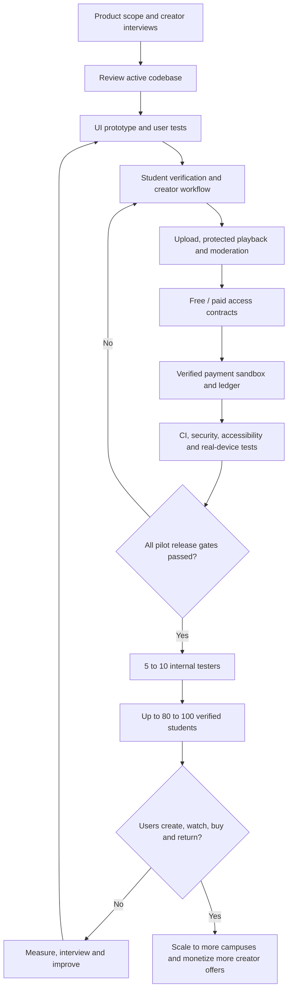

# Student Creators — 80–100 User Pilot and Engineering Release Plan
Status: proposed pilot requirements, not an executed test, deployment, or funded campaign. 23 November 2026.

## Source of truth
Canonical app: srdataml-droid/Student-creator-, not school-learning-platform. This file is supplementary to docs/PRODUCT_SCOPE.md and docs/PROJECT_PROGRESS.md. Preserve existing app and merged features.

At audit time, README / progress documentation describe a creator-first feed, public profiles, follows, likes, moderated comments, text/MP4 local publishing and playback, SQLite verification, messages and communities. Production hosted video, Supabase/RLS, PSP sandbox access, paid purchase entitlements, live cashouts, deployment and full real-device/browser E2E are not independently verified. CI evidence for old commits must not be reused as proof about later commits.

## Who participates
- Founder/developer: product decisions, AI-assisted implementation, code review, release approval and sponsor/payment policy.
- Volunteer collaborators: UX testing, recruiting creators, interviewing students, accessibility and copy improvement. No unsupervised access to identity cards, payment info or confidential customer data.
- Student beta group: first 5–10 internal testers, then controlled expansion to 80–100 verified students.
- PSP/video/security specialists: contracted or reviewed as needed for live money and sensitive systems.

## Build order and acceptance gates
### Gate A — Verify current source
Find exact main SHA, current branches/PRs, migrations and CI state; run a fresh test/build suite and browser smoke. Avoid blindly importing the old school-learning-platform source into this repository.

### Gate B — Creator-first identity and media
Student signs up and verifies institution privately -> sees feed -> creates original video -> declares rights -> submits for moderation -> content is published -> legitimate viewers watch. Verify backend permissions, signed media access, RLS and quality on low-cost Android devices. Creator public aliases must not expose legal ID/email.

### Gate C — Creator restrictions and purchased access
Creator chooses NGN 0 or >= NGN 200 for VIEWING access. Implement per-creator view/comment/DM blocking and private paid-media token issuance. Bought access has explicit terms and a creator-blocked buyer dispute/refund path. No unauthorized static-media URLs.

### Gate D — Payments and accounting
PSP sandbox checkout -> server validates order/reference/amount/currency/environment -> idempotent atomic order/entitlement/creator/platform ledger writes -> creator dashboard pending and available balances -> refund/reversal tests. Real payouts only after provider and legal approval. Define fee bearer, commission, threshold and dispute rules with founder before enabling production charges.

### Gate E — Controlled student pilot
Hosted staging Auth/Postgres/media, tests/alerts/backups, copyright notices and privacy handling. Test with 5–10 participants, fix high-severity issues, then expand to up to 100 students while monitoring creator activity, repeat viewing, purchase conversion, charges, refunds, moderation response and video cost.

### Gate F — Expand based on evidence
Improve DM/community reliability, night classes, paid tutoring and creator portfolios; later add verified sponsor-funded qualified-view rewards. International buyer payments come before multi-country creator payouts.

## Product lifecycle

## Required test matrix (none are claimed as passed here)
| Scenario | Required evidence |
| --- | --- |
| Unverified student | Cannot use protected creator/admin operations |
| Unauthorized media | Cannot access paid stream via guessed URL, expired token or API bypass |
| Creator view block | Prevents new signed playback authorizations; purchase dispute handled |
| Comment and DM blocks | Distinct server-side permission checks; correct privacy behavior |
| Price change | Existing purchase keeps its documented license terms; new order snapshots price |
| Client tampering | Buyer cannot edit server-authorized NGN price |
| Retry/duplicate | Duplicate payment webhook creates only one entitlement and balanced accounting |
| Refund | Reverses access/earnings under documented terms, with audit history |
| Payout | Pending does not count as spendable; no duplicate transfer; provider confirmation required |
| Media | Failed upload, interrupted playback, processing failure and malware rejection behave safely |
| Identity | Students' ID images and legal data inaccessible to other users |
| Recovery | Backup restore works; alerts, audit and operational runbook exercised |
| Real Android testing | Navigation, accessibility, bandwidth and playback tested on slow/mobile networks |

## Provisional calendar (dependent on capacity, not a promise)
Week 1: audit main/CI; recruit users; define creator content access, paid license and block rules.
Week 2: patch or finish verified creator/video flow; run backend and browser tests.
Week 3: test pricing/entitlement/ledger/PSP sandbox with refunds and races.
Week 4: stage with managed services, run real-device/security tests, start limited beta only if gates pass.

## Pilot evidence and metrics
Track the number of verified students, active creators, uploads, returning watchers, watch minutes, paid conversions, creator earnings, cash processing costs, delivery costs, reports and refunds. A product-market fit claim needs repeat activity and convincing user evidence, not registration totals.

## Decisions founder has not yet finalized
Commission, provider fee split, withdrawal minimum (NGN 5000 discussed), whether graduates can keep earning, platform age policy, initial campus, content license duration, paid buyer blocking refund policy, and live PSP/legal arrangements.

## What should NOT happen during this documentation phase
No blind overwrite of existing product app, untested push to main, live transfer, company money movement, secret/public ID upload, unauthorized Supabase changes or claim of deployment.
