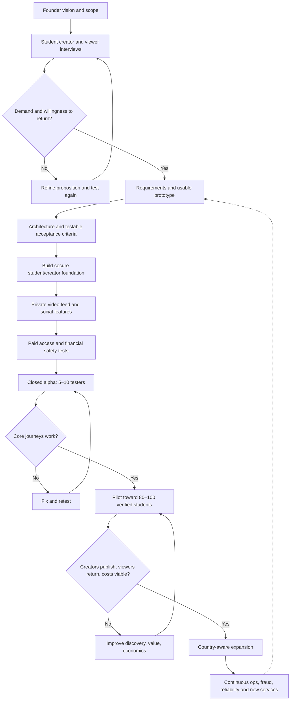
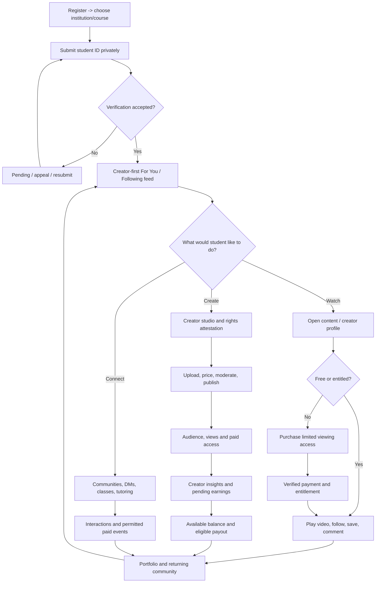
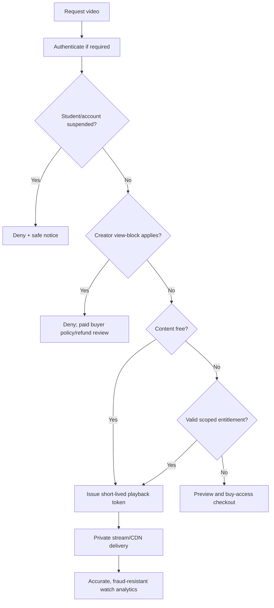
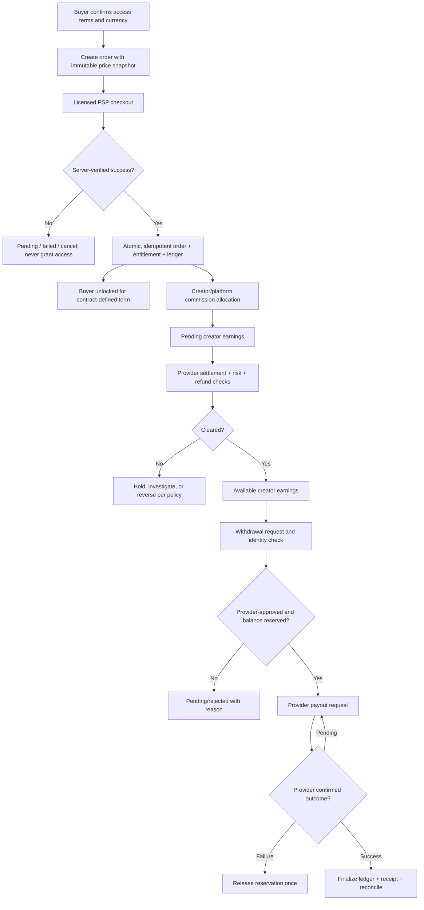
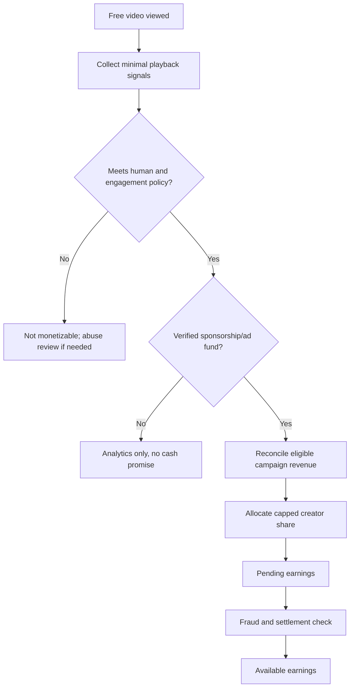
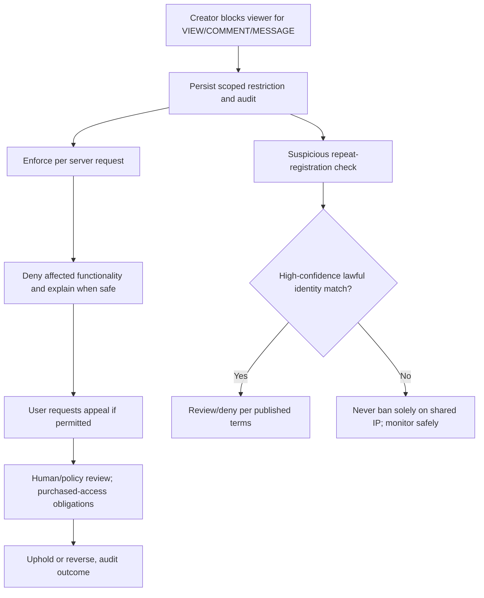
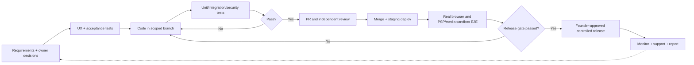
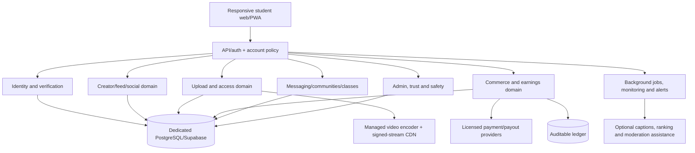

# Student Creators — product, entitlement and engineering process flows
**Date:** 2026-11-23 | **Status:** proposed system behavior; diagrams are not production test evidence.

## A. Founder/product lifecycle

## B. User journey: viewer and creator are the same account

## C. Protected video playback and copyright

Creator retains rights; platform hosts under limited permission, buyer acquires defined access. Moderators/creator block events invalidate future token grants; token TTL and cached permissions require explicitly tested revocation timing. Author-only content settings and institutional privacy must be enforced on the server as well as any PostgreSQL RLS policies.

## D. Purchase, commission, access and payout

## E. Sponsor-funded qualified-view rewards (future)

## F. Creator restrictions and attempted ban evasion

## G. Delivery pipeline for every feature

## H. Logical architecture and dependencies

**Architecture priority:** Modular monolith at 100 users; grow service boundaries based on actual traffic and operations. Use queues for asynchronous media/notifications and separate payment reconciliation processes. Distinguish implementation from planned third-party integrations.

## Release checklist

- Gate 0 source/CI and product contract audited.
- Gate 1 identity, profiles, video and feed browser-tested.
- Gate 2 private playback/creator restrictions/security tests.
- Gate 3 provider sandbox, idempotency, financial ledger, refunds/payout policies.
- Gate 4 closed student beta and low-data mobile performance.
- Gate 5 community/live class/rewards expansion.
- Gate 6 country-specific currency, KYC, tax, privacy and PSP corridor verification.

Refer to `CREATOR_FIRST_PRODUCT_BLUEPRINT_2026-11-23.md`, `CREATOR_COMMERCE_RIGHTS_AND_GLOBAL_STRATEGY_2026-11-23.md` and `PILOT_AND_ENGINEERING_RELEASE_PLAN_2026-11-23.md` for requirements and evidence boundaries.