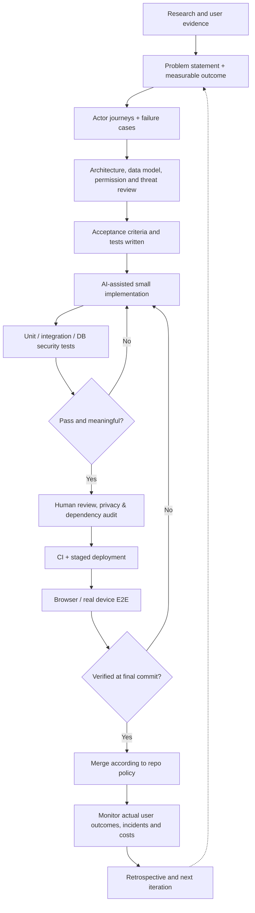

# Engineering Field Guide — Senior-Practitioner Research, Talks, Audio and Application Playbook

**Date:** 23 November 2026  
**Purpose:** A cross-project research reference for AI-assisted engineering, with explicit application to Student Creators Platform.  
**Status:** Curated external research and proposed internal engineering standards. Not a claim that any audio has been downloaded, watched end-to-end, or that app code has been implemented.  
**Reusability:** Worthkind applications may link to this guide or adapt its checklists; product-specific risks still need separate treatment.

## 0. What this is (and is not)

This library points to public writing and official podcast/video pages from experienced engineers, product practitioners and standards bodies. It **does not reproduce books or copyrighted podcast audio**. Links lead to authorized listening/reading sources; some books or services require subscriptions.

Each entry separates:
- **Author's/source's general topic or documented proposition** from
- **Our application recommendation**, which is a product/engineering decision we are proposing.

Read/listen to the primary material before attributing a precise quote or technical claim to a speaker. Update link validity and source currency before high-stakes implementation decisions.

## 1. Curated source library, organized by the product lifecycle

### A. Discover the right product before building
**Marty Cagan / Silicon Valley Product Group — Product discovery and delivery.**  
Primary: https://www.svpg.com/discovery-delivery/  
Additional: https://www.svpg.com/the-origin-of-product-discovery/  
Source focus: product discovery and delivery are distinct yet collaborative activities, involving product, engineering and design.  
**Our application:** Before implementing a large feature, write the target student behavior and the evidence we need. For Student Creators, test whether a student willingly publishes original work, another returns to watch, and any buyer actually pays for access.

**Teresa Torres / Product Talk — Opportunity mapping and continuous discovery.**  
Primary: https://www.producttalk.org/sourcing-opportunities/  
Additional: https://www.producttalk.org/discovering-solutions/  
Source focus: organizing observed needs and possible solutions, then testing candidate approaches.  
**Our application:** Record real student interview evidence separately from assumptions. Avoid creating a conventional school LMS merely because a course filter is easy to build.

**Audio: Lenny's Podcast (product, retention and growth interviews).**  
Listen: https://www.lennysnewsletter.com/p/podcast  
**Our application:** Explore episodes on user interviews, early retention, creator marketplaces and activation; keep notes with exact episode title and link.

### B. Architecture and evolving systems without unnecessary complexity
**Martin Fowler — Strangler Fig Application.**  
Primary: https://martinfowler.com/bliki/StranglerFigApplication.html  
Historical article: https://martinfowler.com/bliki/OriginalStranglerFigApplication.html  
Source focus: incrementally replace parts of an existing system rather than risk an all-at-once rewrite.  
**Our application:** Preserve functioning creator-feed, following and messaging modules; replace old student-learning assumptions in small increments with regression tests rather than resetting the repo.

**Sam Newman — Building Microservices / Monolith to Microservices.**  
Author bibliography: https://samnewman.io/books/  
Audio (O'Reilly interview): https://www.oreilly.com/content/sam-newman-on-building-microservices/  
Audio (InfoQ interview): https://www.infoq.com/podcasts/sam-newman-ddd-microservices/  
Source focus: domain boundaries, deployment trade-offs and the real coordination/operational costs of splitting systems into services.  
**Our application:** Start Student Creators as a modular application with explicit identity, media, commerce, social, moderation and reporting boundaries. Extract services only when scale, security or team ownership requires them.

**Martin Kleppmann — Designing Data-Intensive Applications.**  
Official book site: https://dataintensive.net/  
Author site: https://martin.kleppmann.com/  
Audio/video discussion: https://www.youtube.com/watch?v=SVOrURyOu_U  
Source focus: database/data-processing trade-offs, reliability and distributed-system constraints.  
**Our application:** Understand database transactions, constraints, idempotency, retries and consistency before designing financial balances or global access entitlements.

**Tanya Reilly — The Staff Engineer's Path.**  
Publisher: https://www.oreilly.com/library/view/the-staff-engineers/9781098118723/  
Source focus: technical strategy, leadership without formal authority and organization-scale engineering work.  
**Our application:** Maintain a concise architecture decision record (ADR), explicit owner for each major feature and written trade-offs so volunteer contributors can coordinate.

### C. AI-assisted code is only useful with evidence
**Simon Willison — AI-assisted development needs automated tests.**  
Primary: https://simonwillison.net/2025/May/28/automated-tests/  
Video talk: https://www.youtube.com/watch?v=9RzqagabeOk  
Source focus: automated tests and verifying generated code are essential in professional AI-assisted development.  
**Our application:** Every AI-authored change must include acceptance criteria, tests run in an actual environment, failure cases, proof of behavior and code-review notes. Do not claim a feature is complete because the AI generated code.

**Martin Fowler — Continuous Integration.**  
Primary: https://martinfowler.com/articles/continuousIntegration.html  
Source focus: frequent integration and automated build/test discipline.  
**Our application:** Use small reviewable PRs; run unit, database/authorization, integration, lint/type/build and browser tests as appropriate. Check green status at the exact final commit; do not merge untested payment behavior.

### D. Secure systems and production readiness
**OWASP — Application Security Verification Standard (ASVS).**  
Official: https://asvs.owasp.org/  
Project: https://owasp.org/www-project-application-security-verification-standard/  
Source focus: detailed requirements for verifying technical security controls.  
**Our application:** Turn authentication, server-side access, student ID privacy, content entitlements, safe uploads and moderation into negative acceptance tests.

**Google Site Reliability Engineering and SRE Workbook.**  
Books: https://sre.google/books/  
Workbook: https://sre.google/workbook/index/  
Source focus: monitoring, reliability targets, service-level objectives, incident response and maintaining operating systems.  
**Our application:** Instrument video startup failures, purchase-to-entitlement latency, unauthorized access denials, payment discrepancies and failed uploads. Decide pilot-level reliability and response rules rather than claiming "enterprise-ready" because the stack is scalable.

**Charity Majors — observability and production engineering.**  
Audio/video: https://www.youtube.com/watch?v=SvEjS4-2WJQ  
Podcast page: https://scalingdevtools.com/podcast/episodes/charity  
Source focus: diagnosing real production behavior and observability in AI-era software development.  
**Our application:** Measure real user journeys with correlation IDs and safe logs; never put student identity files, sensitive message contents or payment secrets into telemetry.

**DORA — software delivery performance.**  
Primary: https://dora.dev/insights/dora-metrics-history/  
2025 recap: https://dora.dev/insights/dora-2025-year-in-review/  
Source focus: measuring both speed/throughput and stability of delivery systems.  
**Our application:** Monitor deployment frequency, change lead time, failure recovery and rework, but do not optimize speed at the expense of failed user payments.

**The Twelve-Factor App — deployable application principles.**  
Primary: https://12factor.net/  
Config: https://www.12factor.net/config  
Source focus: environment configuration and separation of build/release/runtime processes for hosted apps.  
**Our application:** Separate secrets and configuration from Git; keep local SQLite as development/rollback only and use a managed persistent datastore before production serverless hosting.

### E. Senior-engineer audio/podcast listening library
These are official or publisher-controlled podcast/video pages, not downloadable audio redistributed by this repository:

1. **StaffEng Podcast** — senior/staff engineers' judgment, direction, mentoring, AI-assisted engineering: https://podcast.staffeng.com/
2. **The Pragmatic Engineer Podcast** — interviews with engineering leaders about startup/large-company systems: https://blog.pragmaticengineer.com/the-pragmatic-engineer-podcast/
3. **Software Engineering Radio** — long-form technical engineering interviews: https://se-radio.net/
4. **Lenny's Podcast** — product discovery, growth and product leadership: https://www.lennysnewsletter.com/p/podcast
5. **Sam Newman (O'Reilly audio)** — gradual service decomposition: https://www.oreilly.com/content/sam-newman-on-building-microservices/
6. **Charity Majors (Pragmatic Engineer interview)** — production observability: https://www.youtube.com/watch?v=SvEjS4-2WJQ
7. **Martin Kleppmann (video interview)** — data-intensive system design: https://www.youtube.com/watch?v=SVOrURyOu_U

For offline study: use the podcast provider's official download/offline feature where offered and permitted; do not commit copyrighted audio, podcast transcripts or paid book PDFs to Git.

## 2. Recommended order of study tied to actual development

| Order | Topic / source | Practice task | Evidence artifact |
|---|---|---|---|
| 1 | Cagan + Torres: discovery | Interview 5 potential viewers and 5 potential creators | Assumptions vs observed needs; opportunity map |
| 2 | Fowler: incremental evolution | Compare current Student Creators repo modules to target creator flow | Compatibility map and ADR |
| 3 | Newman: boundaries | Define identity, video, access/commerce, social, moderation boundaries | Logical architecture diagram |
| 4 | Kleppmann: data | Design order/entitlement and balanced ledger with database constraints | ERD + consistency/failure table |
| 5 | Simon Willison + Fowler: tests/CI | Implement a small feature with passing and failing tests | Exact-commit test log and PR |
| 6 | OWASP: secure boundaries | Attempt unauthorized access to another student's paid video and student ID | Negative test evidence |
| 7 | Google SRE + Charity Majors | Add instrumentation, alert criteria and incident drill | Monitoring dashboard and incident runbook |
| 8 | DORA + Tanya Reilly | Audit delivery performance and architecture decisions | Review retrospective and technical strategy |

## 3. Reusable end-to-end feature delivery method for all Worthkind apps

**Definition of done:** The intended behavior is visible in a real test, critical failure cases are exercised, CI and relevant browser tests passed against the exact commit, security assumptions documented, rollback possible, and it is clear whether the feature is deployed, staged, local-only or merely designed.

## 4. Mandatory feature-review template (copy per task)

- Project / repo / canonical branch:
- Problem and evidence (user research, source links, assumptions):
- User / creator / admin roles and scope:
- Product goal and measurable metric:
- Entry/exit states, input and outputs:
- Data model, authorization boundaries and privacy:
- Known failure and abuse cases:
- Third-party services and contracts:
- AI coding instructions (small scoped change, no secret access):
- Automated tests and exact command/results:
- Browser/real-device checks:
- Observability, cost, backups and rollback:
- Source/commit evidence:
- Production status: NOT STARTED / DOCUMENTED / IMPLEMENTED UNVERIFIED / TESTED LOCAL / CI VERIFIED / STAGING VERIFIED / PRODUCTION VERIFIED
- Remaining blockers, owner approval and next small increment:

## 5. Application to Student Creators Platform — immediate engineering learning priorities

**Priority 1: Creator content access as a security boundary.** Apply OWASP negative-test thinking: creator owns original content; viewer buys an authorization scope, not copyright; backend issues protected playback only after entitlement and block checks. See `docs/CONTENT_ACCESS_COPYRIGHT_BLOCKING_2026-11-23.md`.

**Priority 2: Payments as a state machine.** Apply data-integrity lessons: verified PSP reference, idempotent webhook event, atomic purchase access and balanced earnings ledger, settlement separate from immediately visible sales. Simulate retries, concurrency, provider timeout and refund.

**Priority 3: Product evidence over generic feature quantity.** Start with 5–10 testers; progress toward 80–100 only when the content-to-access journey works. Test student return rate and creator repeat publishing, not merely sign-up totals.

**Priority 4: Modular growth.** Do not rewrite the existing public creator feed, profiles, likes or comments. Improve source modules incrementally with compatibility tests.

**Priority 5: Operate what you build.** Instrument video delivery, failed purchases, fraud review and error reports. The first 100 users need trustworthy support more than a premature microservice architecture.

## 6. Cross-product mapping for Worthkind (examples, not evidence of code completion)

| Project | Senior-practitioner lesson to prioritize |
|---|---|
| Student Creators Platform | Product discovery + media entitlement security + creator ledger |
| Worthkind Flow / Hotel OS | Evolving architecture + provider webhook idempotency + incident reporting |
| USSD Flow | Reliable state machines, platform restrictions, device testing and recovery paths |
| SignalBridge | Database transaction correctness, auditability, authorization and financial reconciliation |
| ChurchScreen AI | Streaming quality, latency budgets, operator approval and safe fallback |
| Student Attendance | Identity/privacy, offline failure modes, fraud and verification tests |
| Landlord & Tenant | Payment/idempotency, recurring invoice integrity and backup/recovery |
| Worthkind Reader & Anchor | Cross-device state consistency, deterministic tests and clear client/server boundaries |

## 7. Notes workflow for audio and published experience

For each episode or article we actually review, create a structured note with:
- Source URL, author/guest, date, exact episode or article title.
- **Source-supported claims** with timestamps or section headings.
- **Our interpretation / relevance** explicitly labeled.
- The rule or experiment it suggests, and the project it applies to.
- A proof task, measurable criterion and whether evidence passed.

Do not silently turn a guest's opinion into a universal standard, fabricate timestamps, or say an episode was listened to if only its listing/description was inspected.

**Next action:** In the canonical Student Creators repo, audit the current code and CI against the immediate priorities, then pick one small implementation PR. Do not claim this research document itself ships any new feature.
